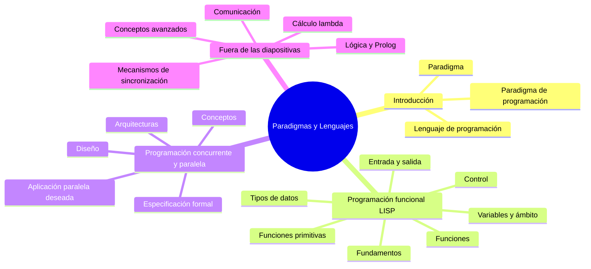
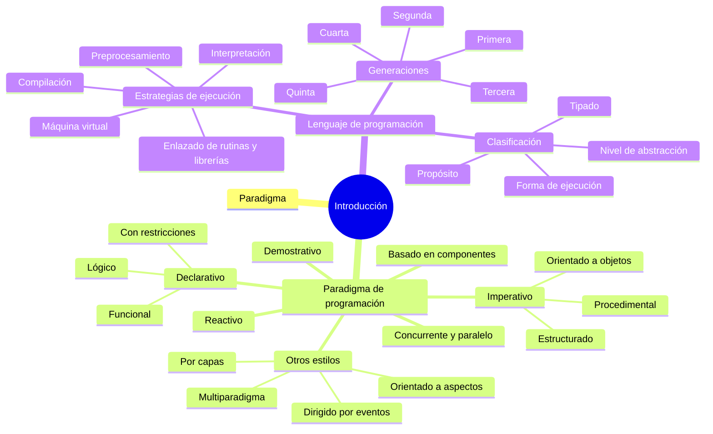
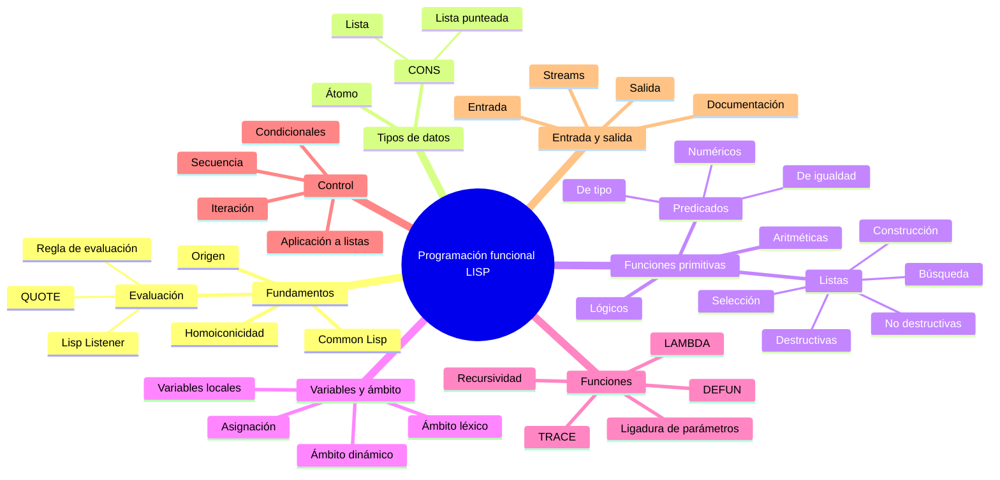
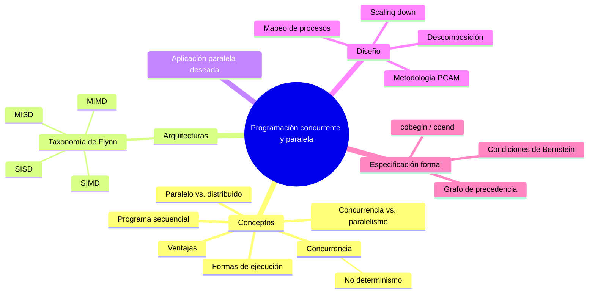
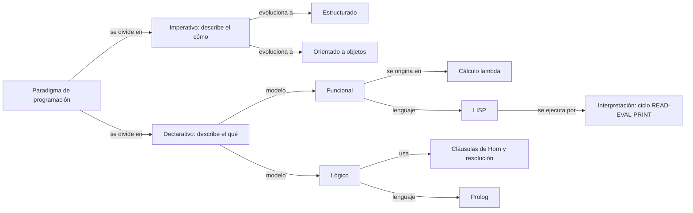
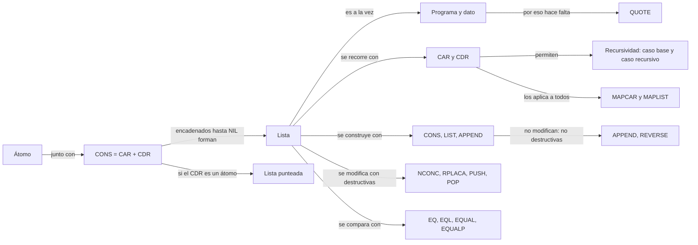
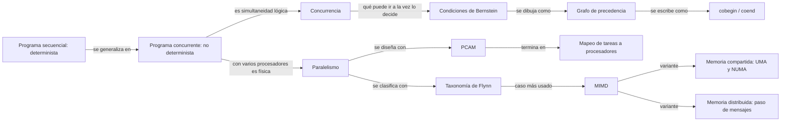

# Mapa conceptual de la teoría

Paradigmas y Lenguajes · Ciclo 2026

Este archivo muestra los conceptos que se toman en la teoría y cómo se relacionan. Los diagramas están en Mermaid: se ven dibujados en GitHub y en la vista previa de Markdown de VS Code. La versión interactiva, que funciona sin conexión y permite desplegar ramas y buscar, está en [mapa-conceptual.html](mapa-conceptual.html).

## Vista general

## Unidad I. Introducción

## Unidad II. Programación funcional

## Unidad III. Programación concurrente y paralela

## Cómo se conectan los conceptos

Los tres diagramas siguientes muestran las relaciones que conviene poder explicar con palabras, porque son las que arman las preguntas de desarrollo.

### De los paradigmas a LISP

### De la estructura CONS a las funciones sobre listas

### De la concurrencia a cobegin/coend

## Cobertura: programa oficial contra diapositivas 2026

| Tema del programa | Contenido | En las diapositivas 2026 | Apunte |
|---|---|---|---|
| 1. Paradigmas y lenguajes | Paradigmas, lenguajes, generaciones, estilos | Completo | 01 |
| 2. Introducción a la programación funcional | Tipos de datos, átomos, listas, funciones, predicados, lambda, ámbito | Completo, salvo every y some | 02, 03, 05 |
| 3. Manejo de listas y arreglos | Construcción, acceso, eliminación | Listas sí; arreglos, A-listas y P-listas no | 03 |
| 4. Control de flujo y recursividad | Secuencia, condicionales, iteración, E/S, recursividad, destructividad | Completo, salvo recursividad de cola | 03, 04, 05 |
| 5. Cálculo lambda | Sintaxis, reducciones, redex, forma normal, confluencia | No está | - |
| 6. Introducción a la programación concurrente | Concurrencia, paralelismo, Bernstein, grafos, cobegin/coend | Completo, salvo exclusión mutua e hilos | 06, 07 |
| 7. Mecanismos | Exclusión mutua, semáforos, monitores, deadlocks | No está | - |
| 8. Comunicación | Taxonomía de Flynn, multiprocesadores, multicomputadoras, diseño de algoritmos; sockets y MPI | Flynn, arquitecturas y diseño sí; sockets y MPI no | 06, 07 |
| 9. Conceptos avanzados | Entidades y ligaduras, tipos, polimorfismo, semántica formal | No está | - |

El modelo de final que circula incluye además preguntas de programación lógica (forma clausal de Horn, reglas de inferencia, árbol SLD), que no figuran como unidad propia en el programa vigente ni en las diapositivas 2026. Conviene confirmar con la cátedra si se siguen tomando.

## Qué tipo de pregunta sale de cada concepto

| Tipo de pregunta del final | Conceptos que la alimentan |
|---|---|
| Definir | Paradigma, lenguaje, concurrencia, CONS, predicado, recursividad, stream |
| Comparar | Imperativo y declarativo; compilación e interpretación; destructiva y no destructiva; CONS, LIST y APPEND; EQ, EQL, EQUAL y EQUALP; léxico y dinámico; concurrencia y paralelismo; memoria compartida y distribuida; UMA y NUMA |
| Enumerar | Tipos de paradigmas; generaciones; características de Common Lisp; características de la recursividad; ventajas de la concurrencia; taxonomía de Flynn; etapas de PCAM; características de una aplicación paralela |
| Opción múltiple | Orígenes de LISP; lista punteada; qué devuelve una expresión; propiedades de COND, SETQ y LET; clasificación de arquitecturas |
| Graficar | Cajas CONS de una lista; grafo de precedencia con Bernstein y cobegin/coend; seguimiento de una función recursiva; árbol SLD |
